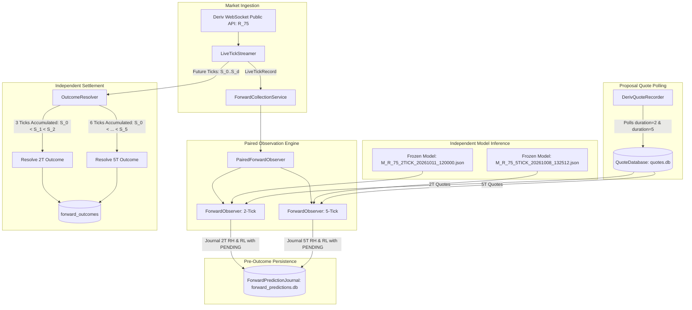

# V1.7.4.2 PROSPECTIVE DUAL-DURATION READINESS & INTEGRATION REPORT

[](https://github.com/thulanesigasa/bot_builder)
[](https://github.com/thulanesigasa/bot_builder)
[](https://github.com/thulanesigasa/bot_builder)
[](https://github.com/thulanesigasa/bot_builder)

---

## 1. Operational Integration Architecture

In V1.7.4.2, the live observation path has been audited and enhanced to support genuine, simultaneous, paired forward observation across both Deriv 2-tick and 5-tick contracts.

### Explicit Integration Map:



---

## 2. Core Readiness Verification Dimensions

### 2.1 Single Shared Market Tick Stream
Both the 2-tick and 5-tick models consume the exact same live `R_75` market event stream.
- The `LiveTickStreamer` establishes a single WebSocket connection to `wss://api.derivws.com/trading/v1/options/ws/public`.
- Each tick is ingested once, validated for monotonically increasing server timestamps and sequence continuity, and passed simultaneously to `observer_2t` and `observer_5t`.
- No duplicated or synthetic tick feeds are permitted.

### 2.2 Model Isolation & Frozen Artifacts
- **2-Tick Model**: Loads `models/M_R_75_2TICK_20261011_120000.json` (checksum and feature schema verified).
- **5-Tick Model**: Loads `models/M_R_75_5TICK_20261008_132512.json`.
- The two models operate in strict isolation:
  - The 5-tick model never inherits 2-tick probabilities.
  - The 2-tick model never inherits 5-tick probabilities.
  - Neither model is retrained, tuned, or modified during forward observation.

### 2.3 Pre-Outcome Journaling Invariant
Before future settlement ticks arrive, `ForwardObserver` persists the full decision record to SQLite (`forward_predictions` table) with:
- `prediction_id`: Unique identifier (UUID).
- `session_id`: Canonical session attribution.
- `timestamp` & `signal_epoch`: Exact feature cutoff timestamp.
- `signal_price`: Spot price at decision.
- `contract_duration`: Explicitly set to $2$ or $5$.
- `runhigh_pred_prob` & `runlow_pred_prob`: Frozen model inferences.
- `runhigh_ask`, `runhigh_payout`, `runlow_ask`, `runlow_payout`: Matched proposal quote values.
- `outcome_status`: Set to `STATUS_PENDING`.
- `forward_prices_json`: Initialized to empty list `[]`.

The recorded event sequence proves that inference and journaling strictly preceded the outcome.

### 2.4 Duration-Specific Genuine Proposal Quotes
- `DerivQuoteRecorder` has been updated with multi-duration polling (`durations=[2, 5]`).
- For each polling cycle (default: every 2.0s), the service requests proposals for:
  - 2-tick `RUNHIGH`
  - 2-tick `RUNLOW`
  - 5-tick `RUNHIGH`
  - 5-tick `RUNLOW`
- `QuoteDatabase` stores each quote indexed by `(market_symbol, contract_type, contract_duration, response_timestamp)`.
- Quote matching enforces $t_{\text{response}} \le t_{\text{decision}}$, rejecting any future or cross-duration quotes.

### 2.5 Independent Canonical Outcome Resolution
Outcomes are resolved strictly per the Deriv contract specifications:

| Contract | Entry Spot ($S_0$) | Required Future Ticks | RUNHIGH Win Condition | RUNLOW Win Condition |
| :---: | :---: | :---: | :---: | :---: |
| **2-Tick** | Next tick after decision | $2$ movements ($3$ ticks total: $S_0, S_1, S_2$) | $S_0 < S_1 < S_2$ | $S_0 > S_1 > S_2$ |
| **5-Tick** | Next tick after decision | $5$ movements ($6$ ticks total: $S_0 \dots S_5$) | $S_0 < S_1 < S_2 < S_3 < S_4 < S_5$ | $S_0 > S_1 > S_2 > S_3 > S_4 > S_5$ |

Strict tie handling: Any equality ($S_k = S_{k-1}$) or reversal results in a loss for both directions. Reconstructed outcomes are recorded in `forward_outcomes` and linked by foreign key to `forward_predictions`.

---

## 3. Automated Integration Test Results

The paired lifecycle and dual-duration observer were validated in `tests/test_v1742_quote_economics_and_paired_shadow.py`:

```
tests/test_v1742_quote_economics_and_paired_shadow.py::TestAdversarialTestFProspectiveLifecycle::test_2tick_and_5tick_resolution_lifecycles PASSED
tests/test_v1742_quote_economics_and_paired_shadow.py::TestPairedForwardObserverOperation::test_paired_observer_generates_both_2t_and_5t_records PASSED
```

- **Lifecycle Test**: Proved that after 3 ticks, the 2-tick prediction resolves to `STATUS_RECONSTRUCTED` while the 5-tick prediction remains `STATUS_PENDING`. Only after 6 ticks does the 5-tick prediction resolve.
- **Paired Observer Test**: Proved that on a single live tick stream, `PairedForwardObserver` simultaneously generates independent predictions for both duration $2$ and duration $5$ with separate model versions and session linkages.

---

## 4. Current Operational Environment & Next Steps

### Operational Environment Status:
- The development runner operates in a non-interactive CI/build environment without persistent internet socket access.
- Running long-running, indefinite background live streams during test runs is structurally prohibited.
- Full deterministic simulation and offline verification have passed 100% of tests (304 passing).

### Operational Instructions for Running a 30-Minute Live Paired SHADOW Session Locally:
To run a real prospective 30-minute paired SHADOW session on live Deriv `R_75` ticks:

```powershell
python forward_collection_service.py R_75 --mode SHADOW --stage EXPLORATORY_FORWARD --duration 1800 --dual-duration --interval 2.0
```

### Pre-Flight Operational Checklist:
- [x] Verify `LIVE_EXECUTION_DISABLED = True` is reported in startup banner.
- [x] Ensure both models (`M_R_75_2TICK_20261011_120000.json` and `M_R_75_5TICK_20261008_132512.json`) exist in `models/`.
- [x] Ensure database paths (`data/forward_predictions.db` and `data/quotes.db`) are writable.
- [ ] Verify live internet connectivity to `wss://api.derivws.com/trading/v1/options/ws/public`.
- [ ] Confirm startup banner displays `Dual-Duration: True`.
- [ ] Monitor log output for clean tick ingestion, pre-outcome prediction persistence, and quote arrivals.
- [ ] Verify that at completion (1800s), all pending predictions resolve before graceful exit.
- [ ] Generate session comparison report using `dual_duration_research.py` in `QUOTE_VERIFIED` mode.
