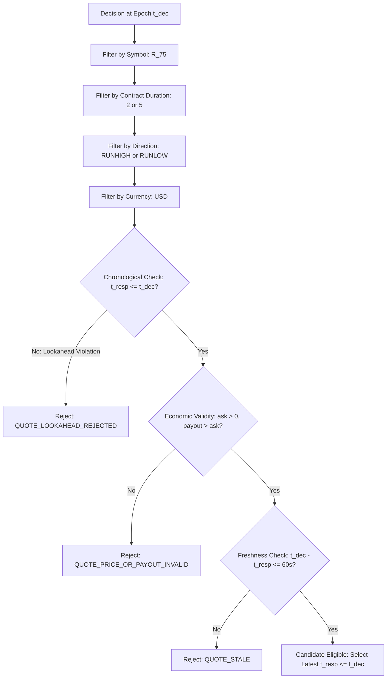

# V1.7.4.2 QUOTE-SPECIFIC ECONOMIC INTEGRITY AUDIT

[](https://github.com/thulanesigasa/bot_builder)
[](https://github.com/thulanesigasa/bot_builder)
[](https://github.com/thulanesigasa/bot_builder)
[](https://github.com/thulanesigasa/bot_builder)

---

## 1. Executive Summary & Defect Overview

In V1.7.4.1 and prior releases, expected value (EV) in `dual_duration_research.py` was computed using:
```python
predicted_ord_ev = (mean_prob * payout) - self.stake
```
Even when `evaluation_mode == EvaluationMode.QUOTE_VERIFIED`, the calculation multiplied the overall average predicted probability by the evaluator's fixed reference payout ($7.63 for 2-tick, $61.07 for 5-tick) and subtracted the configured reference stake ($2.00).

This constituted a critical **economic provenance defect**:
1. It masked intra-session quote variation in broker ask prices and total payouts.
2. It allowed reports to claim "quote-verified EV" without actually incorporating matched proposal prices.
3. If quotes were missing or sparse, it silently fell back to reference payouts rather than failing closed.

In V1.7.4.2, this defect has been surgically corrected. Fixed reference payouts are strictly isolated to `REFERENCE_SCENARIO` mode (which is marked illustrative-only and cannot qualify for trade execution). In `QUOTE_VERIFIED` mode, expected value, break-even hurdles, probability margins, and realized returns are calculated strictly **per-decision** using the actual matched proposal quote. If no eligible quotes exist, quote-verified EV is marked **unavailable (`None`)**; it is never assigned an artificial zero or fallback value.

---

## 2. Corrected Economic Formulation

### 2.1 Per-Decision Formulations
For each decision $i \in \{1, \dots, M\}$ where an individually validated quote $q_i$ exists:

| Metric | Mathematical Formulation | Description |
| :--- | :--- | :--- |
| **Quote Break-Even Hurdle** | $\text{BreakEven}_i = \frac{\text{AskPrice}_i}{\text{TotalPayout}_i}$ | Uses actual quote price, not historical reference hurdle ($0.26212$ or $0.03275$). |
| **Probability Margin** | $\text{Margin}_i = P_{\text{model}, i} - \text{BreakEven}_i$ | Individual margin of edge over the broker's implied pricing. |
| **Quote-Specific Ordinary EV** | $\text{EV}_i = P_{\text{model}, i} \times \text{TotalPayout}_i - \text{AskPrice}_i$ | Ex-ante predicted net economic expectation for decision $i$. |
| **Quote-Specific Realized Return** | $\text{Return}_i = (y_i \times \text{TotalPayout}_i) - \text{AskPrice}_i$ | Retrospective realized return given binary outcome $y_i \in \{0, 1\}$. |

### 2.2 Aggregate Reporting over Eligible Decisions
Let $N$ be the total number of evaluated decisions, and $M \le N$ be the number of decisions with execution-quality quote matches.

| Aggregate Metric | Formulation | Behavior When $M = 0$ |
| :--- | :--- | :--- |
| **Mean Actual Ask Price** | $\overline{\text{Ask}} = \frac{1}{M} \sum_{i=1}^M \text{AskPrice}_i$ | `None` (unavailable) |
| **Mean Actual Payout** | $\overline{\text{Payout}} = \frac{1}{M} \sum_{i=1}^M \text{TotalPayout}_i$ | `None` (unavailable) |
| **Mean Break-Even** | $\overline{\text{BreakEven}} = \frac{1}{M} \sum_{i=1}^M \text{BreakEven}_i$ | `None` (unavailable) |
| **Break-Even Distribution** | $\min, \text{median}, \max, \sigma$ across $\{\text{BreakEven}_i\}$ | `None` (unavailable) |
| **Mean Ordinary EV** | $\overline{\text{EV}} = \frac{1}{M} \sum_{i=1}^M \text{EV}_i$ | `None` (unavailable) |
| **Ordinary EV Per Dollar** | $\frac{\overline{\text{EV}}}{\overline{\text{Ask}}}$ | `None` (unavailable) |
| **Mean Realized Return** | $\frac{1}{M} \sum_{i=1}^M \text{Return}_i$ | `None` (unavailable) |
| **Missing EV Count** | $N - M$ | $N$ |

---

## 3. Explicit Per-Decision Quote Matching Methodology

Each prediction point at timestamp $t_{\text{dec}}$ queries the quote collection across 8 mandatory matching dimensions:



### Strict Matching Dimensions:
1. **Contract Symbol**: Strictly matches `evaluator.symbol` (e.g. `R_75`). Mismatches reject with `QUOTE_WRONG_CONTRACT_OR_SYMBOL`.
2. **Contract Duration**: 2-tick predictions match only duration $2$; 5-tick predictions match only duration $5$. Cross-duration matches are strictly rejected.
3. **Contract Direction**: `RUNHIGH` matches only upward proposals (`RUNHIGH`, `UP`, `RISE`); `RUNLOW` matches only downward proposals (`RUNLOW`, `DOWN`, `FALL`).
4. **Currency**: Must be `USD`.
5. **Zero Lookahead Tolerance**: Quote receipt timestamp $t_{\text{resp}}$ must satisfy $t_{\text{resp}} \le t_{\text{dec}}$. If $t_{\text{resp}} > t_{\text{dec}}$, the quote is rejected under `QUOTE_LOOKAHEAD_REJECTED`. No future tolerance is permitted.
6. **Valid Response Timestamp**: $t_{\text{resp}}$ must be non-null, non-NaN, and positive. Missing timestamps reject with `QUOTE_RESPONSE_TIME_MISSING`.
7. **Economic Price Bounds**: Must satisfy $\text{ask} > 0$, $\text{payout} > 0$, $\text{ask} < \text{payout}$, and `collection_status == 'QUOTE_AVAILABLE'`.
8. **Freshness Bound**: $t_{\text{dec}} - t_{\text{resp}} \le 60.0\text{ seconds}$. Older quotes reject with `QUOTE_STALE`.

---

## 4. Moving-Block Bootstrap over Actual Per-Decision Returns

In prior versions, moving-block bootstrap simulated EV by perturbing the win rate and applying fixed reference payouts:
```python
sample_ev = (sample_win_rate * payout) - stake
```

In V1.7.4.2, when evaluating `QUOTE_VERIFIED` mode:
1. The bootstrap operates on the actual vector of per-decision realized returns:
   $$R_i = (y_i \times \text{TotalPayout}_i) - \text{AskPrice}_i$$
2. Block sizes are set to $L = \max(2, \text{duration} + 1)$ (3 for 2-tick, 6 for 5-tick) to preserve temporal autocorrelation across overlapping settlement windows.
3. If $M < \max(30, 2L)$, the conservative lower bound is marked **unavailable (`None`)** with status `INSUFFICIENT_SAMPLE`.
4. Over $B = 500$ bootstrap iterations, blocks of realized returns are resampled with replacement, and the empirical 5th percentile represents the conservative lower bound.

---

## 5. Adversarial Test Verification

The corrected quote economics were audited through dedicated adversarial tests in `tests/test_v1742_quote_economics_and_paired_shadow.py`:

| Test Identifier | Adversarial Setup | Expected Behavior | Observed Result | Status |
| :--- | :--- | :--- | :--- | :---: |
| **Test A (Variable Payouts)** | Decision 0..19: Ask $2.00, Payout $7.50<br>Decision 20..39: Ask $2.20, Payout $8.50<br>Predicted Prob: $0.30$ | Mean EV must be $(0.25 + 0.35)/2 = +0.30$.<br>Must NOT equal reference EV $0.30 \times 7.63 - 2.00 = +0.289$. | Computed EV: `+0.3000`<br>Reference EV: `+0.2890` (rejected) | **PASSED** |
| **Test C (Missing Quotes)** | 40 decisions with valid historical ticks and probabilities, but zero quotes provided. | Quote-verified EV must be `None`. Missing EV count must be $40$. | `ordinary_ev is None`<br>`missing_ev_count = 40`<br>`verdict = INSUFFICIENT_QUOTE_COVERAGE` | **PASSED** |
| **Test D (Future Quote)** | Quote response received at $t_{\text{dec}} + 0.2\text{s}$. | Must reject with `QUOTE_LOOKAHEAD_REJECTED`. Quote coverage $= 0.0\%$. | `QUOTE_LOOKAHEAD_REJECTED = 1`<br>`cov_pct = 0.0%` | **PASSED** |
| **Test E (Cross Duration)** | 2-tick quote supplied to 5-tick evaluation. | Must reject with `QUOTE_WRONG_CONTRACT_OR_SYMBOL`. | Rejected cleanly;<br>Coverage $= 0.0\%$ | **PASSED** |
| **Stale Quote Test** | Quote response received $100\text{s}$ prior to decision ($> 60\text{s}$). | Must reject with `QUOTE_STALE`. Execution coverage $= 0.0\%$. | `QUOTE_STALE = 1`<br>`exec_cov = 0.0%` | **PASSED** |
| **Invalid Price Test** | Ask price $8.00 \ge \text{payout } 7.63$. | Must reject with `QUOTE_PRICE_OR_PAYOUT_INVALID`. | Rejected cleanly;<br>Zero coverage | **PASSED** |

---

## 6. Audit Conclusion & Invariants

1. **Zero Reference Leakage**: In `QUOTE_VERIFIED` mode, reference payouts are completely absent from EV calculations. Every dollar of expected return is anchored in an empirical broker proposal quote.
2. **Fail-Closed on Missing Quotes**: If quotes are absent or stale, verified EV is `None`, and candidate qualification is blocked.
3. **No Retraining or Parameter Alteration**: Existing model artifacts `M_R_75_2TICK_20261011_120000.json` and `M_R_75_5TICK_20261008_132512.json` remain untouched.
4. **Safety Invariant Maintained**: `LIVE_EXECUTION_DISABLED = True` remains permanently enforced. Real-money purchases are structurally impossible.
