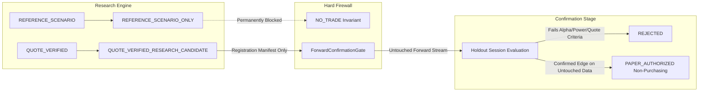

# V1.7.4.2 REFERENCE SCENARIO QUALIFICATION & FAIL-CLOSED AUDIT

[](https://github.com/thulanesigasa/bot_builder)
[](https://github.com/thulanesigasa/bot_builder)
[](https://github.com/thulanesigasa/bot_builder)
[](https://github.com/thulanesigasa/bot_builder)

---

## 1. Previous Permissive Reference-Mode Defect

In `dual_duration_research.py` (V1.7.4.1 line 356), the qualification logic was defined as:
```python
has_valid_quotes = (evaluation_mode == EvaluationMode.REFERENCE_SCENARIO) or (quote_avail_pct >= 90.0)
```
This clause contained a major architectural weakness:
- It permitted historical reference scenarios to automatically satisfy the quote availability requirement.
- When an exploratory backtest or historical replay produced positive hypothetical return ($\text{ordinary EV} > 0$ and $\text{conservative EV} \ge 0$), the evaluator assigned the verdict:
  ```
  ECONOMICALLY_QUALIFIED_CANDIDATE
  ```
  with `is_economically_positive = True`.
- This created the dangerous impression that a purely illustrative reference scenario constituted verified trade eligibility or economic qualification.

---

## 2. Corrected Fail-Closed Logic in V1.7.4.2

In V1.7.4.2, this permissive exception has been completely removed:

### 2.1 Unconditional Economic Disqualification for Reference Scenarios
In `dual_duration_research.py`:
```python
if evaluation_mode == EvaluationMode.REFERENCE_SCENARIO:
    # All results are strictly illustrative. Quote coverage is 0.0%.
    # Reference scenarios can NEVER receive verified economic qualification!
    is_pos = False

    if unc_status == "INSUFFICIENT_SAMPLE":
        verdict = "INSUFFICIENT_UNCERTAINTY_EVIDENCE"
    elif not has_positive_ord:
        verdict = "NEGATIVE_ORDINARY_EV"
    elif not has_positive_cons:
        verdict = "FAILED_CONSERVATIVE_HURDLE"
    else:
        verdict = "REFERENCE_SCENARIO_ONLY"
```

### 2.2 Invariants Enforced
1. `is_economically_positive` is **unconditionally `False`** for all reference scenarios.
2. `winning_candidate` in `DualDurationComparisonReport` evaluates to `None` for reference scenarios.
3. If ordinary EV or conservative EV hurdles fail, the evaluator reports the specific diagnostic failure (`NEGATIVE_ORDINARY_EV` or `FAILED_CONSERVATIVE_HURDLE`).
4. When both hurdles pass, the status is restricted to `REFERENCE_SCENARIO_ONLY`. It can **never** receive `ECONOMICALLY_QUALIFIED_CANDIDATE`, `FORWARD_EDGE_CONFIRMED`, `PAPER_AUTHORIZED`, or `LIVE_AUTHORIZED`.

---

## 3. Authoritative Research Status Taxonomy

To eliminate conflation between research findings and execution permissions, V1.7.4.2 establishes an explicit hierarchy of research classifications:

| Research Classification | Trigger Conditions | Trade Authorization Implication |
| :--- | :--- | :--- |
| **`REFERENCE_SCENARIO_ONLY`** | Evaluated under `REFERENCE_SCENARIO` mode; positive illustrative EV and conservative EV. | **Zero**. Exploratory only. Cannot be traded or promoted. |
| **`INSUFFICIENT_UNCERTAINTY_EVIDENCE`** | Sample size $N < \max(30, 2L)$; conservative moving-block bootstrap bound unavailable. | **Zero**. Blocks any qualification. |
| **`INSUFFICIENT_QUOTE_COVERAGE`** | Evaluated under `QUOTE_VERIFIED` mode; execution-quality quote coverage $< 90\%$. | **Zero**. Missing genuine pricing evidence. |
| **`NEGATIVE_ORDINARY_EV`** | Evaluated under reference mode; ordinary EV $\le 0.0$. | **Zero**. Rejected on point estimate. |
| **`FAILED_ECONOMIC_HURDLE`** | Evaluated under quote-verified mode; quote-specific ordinary EV $\le 0.0$. | **Zero**. Rejected on empirical economics. |
| **`FAILED_CONSERVATIVE_HURDLE`** | 95% moving-block bootstrap lower bound $< 0.0$. | **Zero**. Rejected on statistical uncertainty. |
| **`QUOTE_VERIFIED_RESEARCH_CANDIDATE`** | Evaluated under `QUOTE_VERIFIED` mode; quote coverage $\ge 90\%$; ordinary EV $> 0$; conservative EV $\ge 0$; sample size sufficient. | **Zero**. Valid research candidate **only**; requires independent confirmation before paper trading. |
| **`CONFIRMATION_REQUIRED`** | Candidate passed exploratory/validation stage; must be registered with `ForwardConfirmationGate`. | **Zero**. Awaiting untouched confirmation stream. |

> [!IMPORTANT]
> None of the above classifications grant execution permission. Research candidate classification is strictly segregated from trading authorization.

---

## 4. Adversarial Test Verification (Test B)

The fail-closed qualification logic was independently audited in `tests/test_v1742_quote_economics_and_paired_shadow.py::TestAdversarialTestBPositiveReferenceEV`:

```python
def test_positive_reference_ev_gets_reference_scenario_only(self):
    evaluator = DualDurationEvaluator(symbol="R_75", stake=2.00, payout_2t=7.63)

    # 50 outcomes with 40 wins (80% win rate -> strongly positive EV in reference scenario)
    outcomes = [1.0] * 40 + [0.0] * 10
    pred_probs = [0.80] * 50
    timestamps = [float(i) for i in range(50)]

    summary = evaluator._compute_metrics(
        label="2T_RUNHIGH",
        duration=2,
        direction="RUNHIGH",
        outcomes=outcomes,
        pred_probs=pred_probs,
        payout=7.63,
        hurdle=2.00 / 7.63,
        evidence_class=EvidenceClass.HISTORICAL_REPLAY,
        evaluation_mode=EvaluationMode.REFERENCE_SCENARIO,
        decision_timestamps=timestamps,
        quote_records=None,
        min_ordinary_ev=0.0,
        min_conservative_ev=0.0
    )

    # Both ordinary EV and conservative EV are strongly positive
    assert summary.ordinary_ev > 0.0
    assert summary.conservative_ev_bootstrap is not None
    assert summary.conservative_ev_bootstrap > 0.0

    # BUT: Must fail-closed!
    assert summary.is_economically_positive is False
    assert summary.verdict == "REFERENCE_SCENARIO_ONLY"
    assert summary.quote_availability_pct == 0.0
```

### Result:
- **Status**: `PASSED`
- Despite an 80% win rate generating high hypothetical EV ($+4.1040) and positive conservative lower bound ($+2.5760$), `is_economically_positive` remained strictly `False` and `verdict` was strictly `REFERENCE_SCENARIO_ONLY`.

---

## 5. Confirmation-Gate Isolation Firewall



### Key Architectural Isolation Guarantees:
1. **No Direct Execution Path**: No function in `dual_duration_research.py`, `research.py`, or `run_edge_research.py` has access to order placement.
2. **Registration Requirement**: A candidate must be registered via `ConfirmationManifest` into the `ForwardConfirmationGate` before prospective evaluation can even begin.
3. **Permanent Safety Guard**: `LIVE_EXECUTION_DISABLED = True` is hardcoded across all services. Even a `CONFIRMED` candidate in the confirmation gate only achieves paper simulation authorization. Real-money orders remain impossible.
